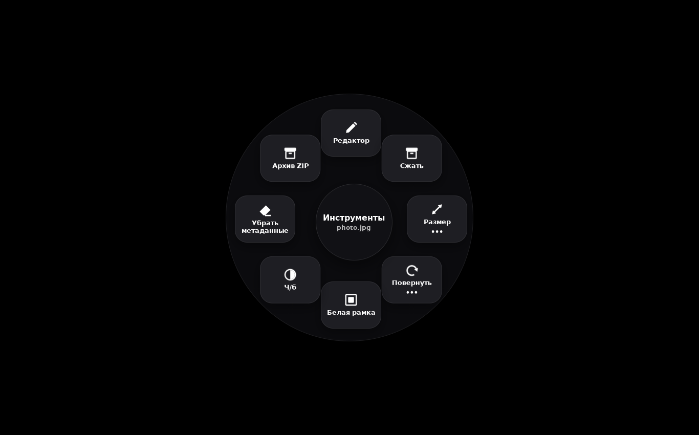
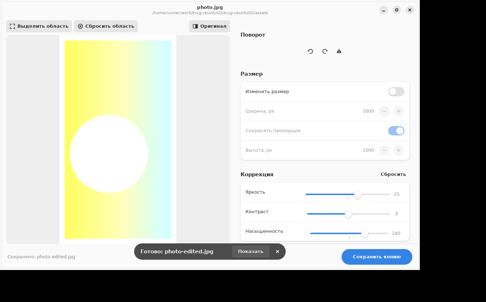
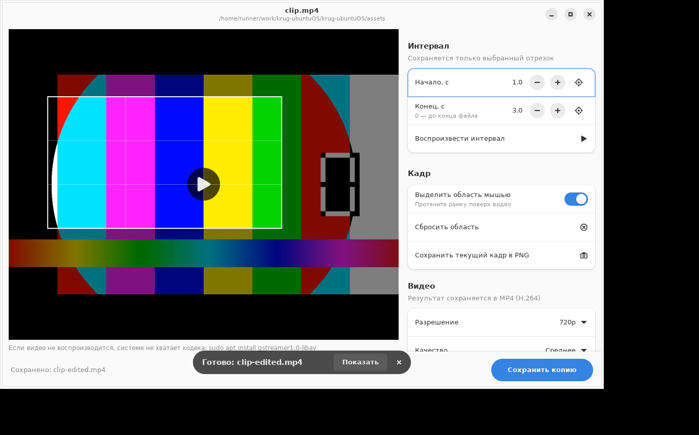
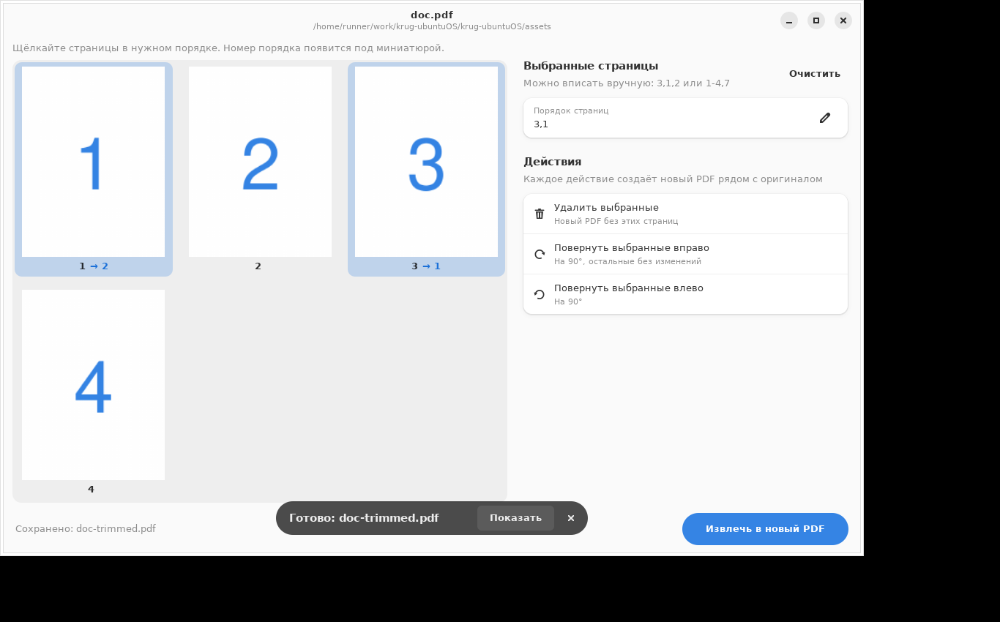

# krug

Круглое меню для файлов в Ubuntu: конвертация, инструменты и действия без открытия отдельных программ. Всё выполняется на вашем компьютере, файлы никуда не отправляются.

Идея взята у приложения khlz для macOS и Windows. Код написан с нуля для Ubuntu с GNOME (Wayland).

Интерфейс на GTK4 и libadwaita — в современном стиле GNOME.

> Версия 0.2.0, предварительная. Каждое изменение проверяется в GitHub Actions на чистом Ubuntu: все операции меню выполняются настоящими программами, все окна открываются и снимаются на скриншоты.



## Как это выглядит в работе

1. Выделите один или несколько файлов в «Файлах» (Nautilus).
2. Нажмите сочетание клавиш или сделайте правый клик → **krug**.
3. Под указателем появится светлое кольцо: в середине миниатюра файла, вокруг карточки команд. Щёлкните нужную.
4. Результат появится рядом с оригиналом под новым именем, придёт уведомление.

| Клавиши | Меню | Что внутри |
| --- | --- | --- |
| **Ctrl+Alt+1** | Конвертация | Перевод файла в другой формат |
| **Ctrl+Alt+2** | Инструменты | Сжатие, размер, поворот, работа с PDF, видео и звуком, архивы |
| **Ctrl+Alt+3** | Действия | Копирование, перемещение, путь в буфер, удаление фона, отправка на телефон |

Управление кольцом:

- **Shift** — конвертация, **Ctrl** — отправить, скопировать или переместить, **Alt** — редактировать и другие инструменты: нажмите клавишу, пока кольцо открыто, и оно переключится на этот набор (как в khlz). Над кольцом видно, какой набор открыт;
- щелчок по кнопке запускает команду, кнопка с точками `•••` открывает вложенный список;
- щелчок в середине возвращает назад или листает страницу, если команд больше восьми;
- щелчок мимо кольца, правая кнопка или **Esc** закрывают меню;
- с клавиатуры: цифры **1–8** выбирают кнопку, **←/→** и **Tab** перемещают выделение, **Enter** запускает, **Page Up/Down** и колесо листают страницы.

Если для команды не хватает внешней программы, кнопка тусклая; при наведении под кольцом видна команда установки.

## Правила, которые соблюдаются всегда

- **Оригинал не меняется.** Любая команда создаёт новый файл.
- **Ничего не перезаписывается.** Если имя занято, результат называется `имя (2).pdf`, затем `имя (3).pdf`.
- **Результат лежит рядом с оригиналом.** Исключение одно: «Копировать в…» и «Переместить в…», где папку выбираете вы.
- **Никакой сети.** Программа запускает только локальные утилиты. Исключение: «На телефон» передаёт файл через KDE Connect по вашей сети Wi-Fi.
- **Меню зависит от типа файлов.** Если выделены файлы разных типов (например, PDF и PNG), меню «Конвертация» пустое, в «Инструментах» остаётся только архив.

## Меню «Конвертация»

| Выделено | Во что можно перевести | Чем выполняется |
| --- | --- | --- |
| PNG, JPEG, HEIC, TIFF, BMP, WebP, AVIF, GIF | PNG, JPEG, WebP, AVIF, TIFF, BMP; **PDF** (все выделенные изображения в один файл, по странице на изображение) | ImageMagick, img2pdf |
| DOC, DOCX, ODT, RTF, TXT, MD | PDF, DOCX, ODT, RTF, TXT | LibreOffice |
| XLS, XLSX, ODS, CSV, TSV | PDF, XLSX, ODS, CSV | LibreOffice |
| PPT, PPTX, ODP | PDF, PPTX, ODP | LibreOffice |
| PDF | текст TXT; страницы в PNG или JPEG (папка `имя-pages`, 150 точек на дюйм) | poppler |
| MP3, WAV, FLAC, OGG, M4A, AAC, OPUS, WMA | MP3, WAV, FLAC, OGG, M4A, OPUS | FFmpeg |
| MP4, MOV, MKV, WebM, AVI и другие видео | MP4 (H.264), WebM (VP9), MKV (без перекодирования), GIF, звук в MP3 | FFmpeg |

Формат, в котором файл уже находится, в списке не показывается. При переводе в JPEG и BMP прозрачность заменяется белым фоном.

## Меню «Инструменты»

**Изображения**

- *Сжать*: JPEG с качеством 75 без метаданных; PNG остаётся PNG, но с палитрой 256 цветов.
- *Размер*: 50 %, 25 % или вписать в 2560, 1920, 1280, 800 пикселей по длинной стороне (маленькие изображения не увеличиваются).
- *Повернуть*: на 90° вправо или влево, на 180°, зеркально.
- *Белая рамка*: поля шириной 5 % с каждой стороны.
- *Ч/б*: перевод в оттенки серого.
- *Убрать метаданные*: удаляет EXIF, в том числе координаты съёмки.

**PDF**

- *Объединить*: несколько выделенных PDF в один, в порядке выделения.
- *Разделить по страницам*: папка `имя-split` с отдельным PDF на каждую страницу.
- *Сжать*: пересборка через Ghostscript с уменьшением картинок; текст остаётся текстом.
- *Повернуть*: все страницы на 90° или 180°.

**Видео**

- *Сжать*: MP4 (H.264, CRF 28).
- *720p*: уменьшение до высоты 720 пикселей.
- *Убрать звук*: без перекодирования видео.
- *Скорость ×2*.
- *Кадр в PNG*: первый кадр.

**Звук**: сжать в MP3 128 кбит/с, свести в моно, ускорить в 1,5 раза.

**Архивы**: *Архив ZIP* для любых файлов и папок; *Распаковать* для ZIP в новую папку. Архивы со ссылками и путями, ведущими за пределы папки, не распаковываются.

## Меню «Действия»

| Команда | Что делает |
| --- | --- |
| Удалить фон | Только для изображений. Создаёт `имя-no-background.png` с прозрачным фоном. Локальная модель rembg, ставится отдельно |
| Копировать путь | Полные пути выделенных файлов в буфер обмена, по одному в строке |
| Копировать имя | Имена файлов в буфер обмена |
| Копировать файл | Сами файлы в буфер: дальше в «Файлах» работает «Вставить» |
| Копировать в… | Спрашивает папку и копирует туда |
| Переместить в… | Спрашивает папку и переносит туда. Единственная команда, после которой файла нет на прежнем месте |
| Дубликат | `имя (копия).ext` рядом с оригиналом |
| Терминал здесь | Открывает терминал в папке файла |
| На телефон | Отправляет файлы на первый доступный телефон через KDE Connect. Телефон нужно заранее связать |

## Редакторы с предпросмотром

Открываются из меню «Инструменты» → **Редактор** (для PDF — **Страницы**) или командой `krug edit ФАЙЛ`. Сохранение всегда создаёт копию рядом с оригиналом; после сохранения внизу появляется кнопка «Показать». Если выделено несколько файлов, их можно переключать в заголовке окна, настройки применяются ко всем.

**Фото.** Выделение области мышью (обрезка), поворот и зеркало, новый размер с сохранением пропорций, яркость, контраст, насыщенность, белая рамка, формат (JPEG, PNG, WebP, AVIF, TIFF) и качество. Предпросмотр обновляется сразу; кнопка «Оригинал» показывает исходник.



**Видео.** Воспроизведение, начало и конец отрезка (кнопка-прицел берёт текущий момент), «Воспроизвести интервал», обрезка кадра рамкой поверх видео, разрешение, качество, скорость, удаление звука, сохранение текущего кадра в PNG. Результат — MP4 (H.264).



**Звук.** Отрезок, формат (MP3, M4A, OGG, OPUS, WAV, FLAC), битрейт, моно, скорость.

**Страницы PDF.** Миниатюры всех страниц; щёлкайте их в нужном порядке, и под миниатюрой появится номер порядка. Затем: извлечь выбранные в новый PDF, удалить выбранные или повернуть их.



## Главное окно

Открывается из списка приложений («krug») или командой `krug`. Три вкладки:

- **Начало** — как пользоваться, кнопки трёх меню (выбрать файлы и открыть меню), переключатель сочетаний клавиш;
- **Журнал** — последние операции, созданные файлы и кнопка «Показать в «Файлах»»;
- **Компоненты** — какие внешние программы найдены и готовая команда `sudo apt install` для недостающих.

## Установка

Нужны Ubuntu с GNOME и «Файлы» (Nautilus). Проверялось в расчёте на Ubuntu 26.04.

```bash
git clone https://github.com/JamShukrikhudo/krug-ubuntuOS.git krug
```

```bash
bash krug/install.sh
```

Установщик:

1. показывает, каких системных пакетов не хватает, и по вашему согласию ставит их через `apt` (единственное место, где нужен пароль);
2. копирует программу в `~/.local/share/krug`, команду запуска в `~/.local/bin/krug`;
3. кладёт расширение «Файлов» в `~/.local/share/nautilus-python/extensions`;
4. добавляет «krug» со значком в список приложений;
5. добавляет в «Файлы» скрипты krug с сочетаниями Ctrl+Alt+1/2/3;
6. перезапускает «Файлы» и печатает, какие внешние программы найдены.

Необязательные компоненты:

```bash
pipx install "rembg[cpu,cli]"
```

```bash
sudo apt install kdeconnect
```

Первый нужен для удаления фона (при первом запуске скачает модель около 170 МБ), второй для отправки на телефон.

Обновление: `cd krug && git pull && bash install.sh`. Удаление: `bash krug/uninstall.sh`, системные пакеты остаются.

## Командная строка

```text
krug                                   главное окно
krug convert|tools|actions [ФАЙЛЫ...]   открыть меню; без файлов берётся выделение из «Файлов»
krug edit ФАЙЛЫ...                      редактор с предпросмотром
krug list convert|tools|actions ФАЙЛЫ  показать пункты меню текстом, без окна
krug check                             какие внешние программы найдены
krug hotkeys install|remove            добавить или убрать сочетания в «Файлах»
```

## Отличия от khlz и ограничения

- **Кольцо открывается сочетанием, а не зажатым Shift, Ctrl или Alt.** Wayland не разрешает программам слушать клавиши в чужих окнах, поэтому первое открытие — Ctrl+Alt+1/2/3 или правый клик. Дальше Shift, Ctrl и Alt переключают наборы прямо в кольце.
- **На рабочем столе** значки рисует расширение Desktop Icons NG (DING), а не «Файлы». Для него krug ставит маленькое расширение GNOME Shell `krug@krug.github.io`: пока в фокусе рабочий стол, оно ловит Ctrl+Alt+1/2/3 и просит DING запустить скрипт krug с выделенными значками. Включается после повторного входа в сеанс.
- **Сочетания работают в окне «Файлов».** Это скрипты «Файлов» (`~/.local/share/nautilus/scripts`) с клавишами из `~/.config/nautilus/scripts-accels`: так «Файлы» сами передают выделенные файлы. Те же три команды есть в правом клике → «Скрипты». Вне «Файлов» используйте `krug <меню> ФАЙЛ`.
- **Кольцо рисуется в прозрачном окне на весь экран**, потому что Wayland не даёт поставить окно под указатель.
- Нет плавающей полки, значка в трее (GNOME его не показывает без расширений), OCR, PDF → DOCX. В редакторах одна область выделения, без масок и монтажа дорожек.
- Нет ограничений на размер и число файлов; длинные задачи идут до 15 минут на одну команду.
- Оформление документов Office зависит от установленных шрифтов.

## Устройство

| Файл | Назначение |
| --- | --- |
| `krug/ops.py` | Все операции и сборка трёх меню по типу файлов |
| `krug/menu.py` | Круглое меню: кнопки с иконками вокруг указателя, запуск операций в фоне |
| `krug/editors/` | Редакторы фото, видео/звука и страниц PDF |
| `krug/app.py` | Главное окно: инструкция, журнал, компоненты |
| `krug/params.py` | Настройки редакторов и сборка аргументов ImageMagick, FFmpeg, qpdf |
| `krug/ui.py` | Общие стили libadwaita, строки настроек, выделение области мышью |
| `krug/icons/` | Свои символьные иконки (рисует `tools/make_icons.py`) |
| `krug/history.py` | Журнал операций в `~/.local/state/krug` |
| `krug/hotkeys.py` | Скрипты и сочетания клавиш «Файлов» |
| `krug/util.py` | Имена результатов, запуск внешних программ, буфер обмена |
| `nautilus/krug_nautilus.py` | Расширение «Файлов»: правый клик и передача выделения |
| `tests/test_krug.py` | Тесты логики без окна и без внешних программ |
| `tests/ops_smoke.py` | Все пункты меню на настоящих файлах и программах |
| `tests/gui_smoke.py` | Открывает каждое окно, сохраняет результаты редакторов, снимает скриншоты |

Тесты логики:

```bash
python3 -m unittest discover -s tests
```

Полная проверка идёт в GitHub Actions (`.github/workflows/ci.yml`); скриншоты окон лежат в артефакте `screenshots` каждого запуска.

## Лицензия и участие

Код открыт под лицензией [MIT](LICENSE): его можно использовать, менять и распространять, в том числе в своих проектах. Доработки приветствуются: сделайте форк и пришлите pull request, об ошибках пишите в Issues (личные файлы не прикладывайте).
